# Clad product roadmap

> **Status:** living document · **Last updated:** 2026-07-08
> **Audience:** contributors and AI agents executing roadmap work. Each horizon links to a detailed implementation plan where one exists. The [Binding principles](#binding-principles) are hard constraints — any implementation that violates one is wrong even if it works.

## Product thesis

Clad is the permission, approval, and audit layer between AI agents and a person's financial life. The bet: as personal agents absorb the jobs of PFM apps, the scarce product is not *showing* financial data to a human — it is making it safe for an agent to *see and act on* money under user-defined policy. Clad is local-first: financial data lives in encrypted stores on the user's machine, and Clad-operated infrastructure is never a party to it.

Positioning in one line: read-only "finance data via MCP" is commoditizing (Era, Monarch/Copilot MCP bolt-ons); the durable quadrant is agent-first + money-movement, entered through policy/approvals/audit — which is what `@clad/core` already is.

## Binding principles

| # | Principle | Practical meaning |
|---|-----------|-------------------|
| P1 | Clad servers are never a party to financial data | No proxying of transactions/balances through Clad-operated infrastructure. Hosted components are stateless and metadata-only; anything user-content-bearing must be E2E-encrypted. This rules out a company-credentialed Plaid proxy. |
| P2 | Secrets never ship in binaries | No company aggregator credentials in any client. Users bring their own Plaid keys, or use aggregators whose credentials are user-owned and client-usable (SimpleFIN). |
| P3 | Monetize action and control, not data | No affiliate recommendations, no data sales, no card-linked-offer monetization without explicit revisit of this principle. Revenue comes from paid convenience (sync/relay) and, later, authorization infrastructure. |
| P4 | Local-first storage | Tokens, transactions, audit log, approvals: encrypted SQLite on the user's machine (see `packages/plaid-adapter/src/token-store.ts` for the reference pattern). |
| P5 | Every agent action passes policy → approval → audit | New surfaces (desktop UI, mobile approvals, card auth) are new frontends to the same `@clad/core` engine, never bypasses of it. |

## Horizons

```mermaid
flowchart LR
  subgraph H0["H0 · Local-first beta (now)"]
    A1["Electron desktop app<br/>(unsigned, GitHub download)"]
    A2["BYO Plaid keys"]
    A3["SimpleFIN adapter"]
  end
  subgraph H1["H1 · Real distribution"]
    B1["Signed + notarized DMG,<br/>auto-update"]
    B2["Approvals UX polish,<br/>safe-to-spend surfaces"]
    B3["Windows port (gated)"]
  end
  subgraph H2["H2 · Hosted edges (stateless)"]
    C1["Approval push:<br/>PWA web push / SMS deep links"]
    C2["Remote MCP relay<br/>for mobile agents"]
    C3["E2E-encrypted sync<br/>(paid tier)"]
  end
  subgraph H3["H3 · Authorization layer"]
    D1["Card-linked real-time layer<br/>(existing cards, via relay)"]
    D2["Issued controlled-spend card:<br/>policy engine as authorizer"]
    D3["Agent-payment rails integration"]
  end
  H0 --> H1 --> H2 --> H3
```

### H0 — Local-first beta (now → ~6 weeks)

Everything runs on the user's machine. Free. Audience: developers downloading from GitHub.

- Electron desktop app: MCP server lifecycle, approvals inbox with native notifications, audit viewer, dashboard, policy editor. → [Desktop app implementation plan](./plans/desktop-app.md)
- Data sources: BYO Plaid keys (existing `clad connect`) and SimpleFIN Bridge (user-pays, no developer account needed). → [SimpleFIN adapter plan](./plans/simplefin-adapter.md)
- Distribution: unsigned direct download; README documents macOS Gatekeeper "Open Anyway" flow. No auto-update yet (requires signing).

### H1 — Real distribution (requires: H0 shipped, first external users)

- Apple Developer ID ($99/yr) + notarization in CI; DMG + ZIP; `electron-updater` against GitHub Releases.
- Windows: keep CI build green from day one; publish binaries only when a real Windows user exists. Microsoft Store (MSIX, ~$19 one-time, Store signs) preferred over Authenticode when that day comes. Mac App Store: **permanent non-goal** (App Sandbox is incompatible with spawning MCP servers and writing Claude Desktop config).
- Pre-purchase "safe to spend" surfaces: widget/menu-bar quick check; groundwork for mobile.

### H2 — Hosted edges (requires: recurring weekly active users asking for mobile/notifications)

One small hosted service accretes stateless jobs; each is optional and none stores financial data (P1):

1. Approval notifications: PWA with web push (works on iOS ≥16.4 installed PWAs) + SMS deep links (never approve-by-reply). Approval decisions write back to the desktop store through the relay.
2. Remote MCP relay: desktop holds persistent outbound connection; claude.ai/mobile connects via HTTPS+OAuth. Enables "can I afford this?" from a phone.
3. E2E-encrypted multi-device sync — the first paid tier (Obsidian Sync model). Server stores ciphertext only.

Revenue starts here: subscription for sync + relay + push bundle.

### H3 — Authorization layer (decision-gated, not time-gated)

- Card-linked real-time layer on existing cards (Fidel-class transaction streams): seconds-after-swipe budget impact push + remediation actions. Requires the H2 relay (webhooks need a server). Likely the flagship paid feature: "live budget on the cards you already have."
- Issued controlled-spend card via BaaS (Lithic Auth Stream Access / Stripe Issuing real-time auth): `@clad/core` policy engine answers approve/decline in <2s. Scoped to spend the user wants governed (subscriptions, discretionary envelopes, agent-initiated purchases) — not a rewards daily-driver. This is the same infrastructure that authorizes agent payments as Visa Intelligent Commerce / Mastercard Agent Pay volume materializes.
- Gate to enter H3: policy engine battle-tested by H0–H2 users; agent-payment rails showing real consumer volume; appetite for program-management obligations (KYC flows, disputes, support) confirmed.

## Non-goals (standing)

- Mac App Store distribution (sandbox-incompatible).
- Any financial-data proxy through Clad servers (P1).
- Embedding company aggregator credentials in clients (P2).
- Affiliate/recommendation monetization (P3).
- Competing as a rewards card issuer.
- Linux support (until demanded).

## Known risks

| Risk | Watch item | Mitigation |
|------|-----------|------------|
| `node:sqlite` availability in Electron's bundled Node | Spike S0.2 answers this | `better-sqlite3` fallback behind the existing shim seam |
| Agentic-commerce timing (H3 revenue thesis) | Rails volume, ~1% shopper adoption today | H0–H2 are cheap; H3 is decision-gated |
| Aggregator dependency (SimpleFIN→MX; Plaid pricing) | SimpleFIN rate limits (~24 req/day) already constrain adapter design | Multi-adapter architecture keeps switching cost low |
| Support burden of bank connections | Every broken connection is a ticket | Beta stays BYO/self-serve; paid tiers gate support load to paying users |
| SmartScreen/Gatekeeper reputation for a new publisher | User-facing install friction | Signing (H1), Microsoft Store path for Windows |

## How this maps to tickets

Work items live in the session task list today and will migrate to Linear. Branch naming once Linear IDs exist: `{ISSUE_ID}/{kebab-case-title}`. The two implementation plans below are written to be executable by an agent without further context:

- [plans/desktop-app.md](./plans/desktop-app.md) — spike S0.1–S0.4, phases D1–D4
- [plans/simplefin-adapter.md](./plans/simplefin-adapter.md) — tasks SF1–SF7
